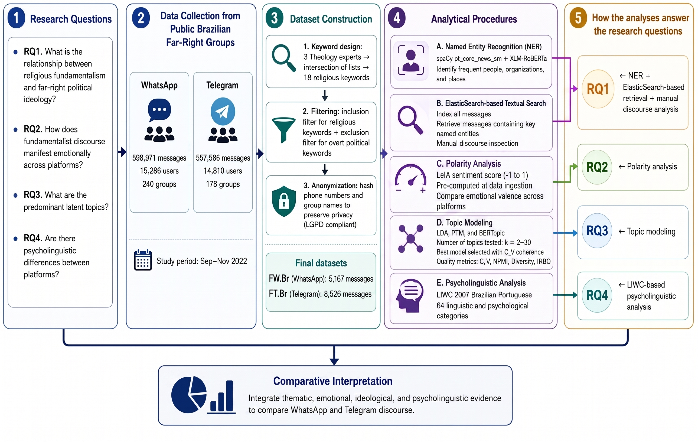

# Religious Fundamentalism and Far-Right Ideology in Brazilian WhatsApp and Telegram Groups

Code and data for the paper

> F. Nascimento, M. S. Felipe, L. Torres, I. Claudino, J. M. Monteiro, J. Machado.
> **Religious Fundamentalism and Far-Right Ideology in Brazilian WhatsApp and Telegram Groups: A Multidimensional Computational Analysis.**
> WebMedia 2026 — Brazilian Symposium on Multimedia and the Web, Lavras/MG, Brazil.



## How to run

```bash
git clone https://github.com/jmmfilho/fundamentalismoreligioso-whatsapp-telegram
cd fundamentalismoreligioso-whatsapp-telegram
git lfs install && git lfs pull          # downloads the datasets (~520 MB)
pip install -r requirements.txt
python -m spacy download pt_core_news_sm # only for notebook 02
jupyter notebook notebooks/
```

Open the notebooks in order and use **Run All**. Each one ends with a cell that compares its
results with the values in the paper.

| Notebook | Paper |
|---|---|
| `01_datasets.ipynb` | Sec. 3.1, Table 1, Figure 2 — builds FW.Br and FT.Br |
| `02_named_entities.ipynb` | Sec. 4.1, Table 2 |
| `03_message_retrieval.ipynb` | Sec. 4.2 — most shared messages, search by entity |
| `04_polarity.ipynb` | Sec. 4.3, Table 3 |
| `05_topics_lda.ipynb` | Sec. 4.4, Tables 4–7 (LDA) |
| `06_topics_ptm.ipynb` | Sec. 4.4, Tables 4–7 (PTM) |
| `07_topics_bertopic.ipynb` | Sec. 4.4, Tables 4–7 (BERTopic) |
| `08_liwc.ipynb` | Sec. 4.5 |

Notebook 01 saves the filtered datasets in `datasets/processed/`; the other notebooks load them
(and build them first if they are missing, so any notebook can be run on its own).
Parameters (keywords, excluded IDs, stopwords, seed) are in `notebooks/utils.py`.
Results are written to `results/`. Notebooks 02 and 07 are much faster with a GPU.

## Repository

```
datasets/    raw WhatsApp and Telegram exports (Git LFS) and the LIWC 2007 Portuguese dictionary
notebooks/   the analysis, one notebook per section, plus utils.py
results/     created by the notebooks
docs/        REPRODUCIBILITY_NOTES.md: what was checked against the paper and known differences
legacy/      original notebooks and results, and experiments not used in the paper
```

## Data

Messages from **public** WhatsApp and Telegram groups associated with the Brazilian far right,
collected with the BATMAN platform from 27 Sep to 14 Nov 2022. Member and group identifiers are
pseudonymised with cryptographic hashes (LGPD, Law No. 13,709/2018; CNS Resolutions No. 510/2016,
466/2012 and 674/2022). Use the data for research only, do not try to re-identify people and do not
republish message text that identifies private persons.

| | Raw messages | Users | Groups | After filters | Unique |
|---|---|---|---|---|---|
| FW.Br (WhatsApp) | 598,971 | 15,286 | 240 | 5,167 | 4,329 |
| FT.Br (Telegram) | 557,586 | 14,810 | 178 | 8,526 | 6,462 |

Main columns: `date_message`, `id_member_anonymous`, `id_group_anonymous`,
`text_content_anonymous`, `trava_zap`, `score_sentiment` (LeIA score computed by the platform),
`id_message`.

## Citation

See [`CITATION.cff`](CITATION.cff).

## Acknowledgments

Lenovo and the National Institute of Science and Technology for Combating Prejudice (INCT Preconceitos).
